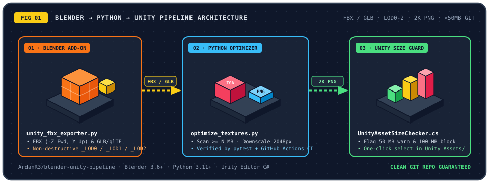

# blender-unity-pipeline

[](https://github.com/ArdanR3/blender-unity-pipeline/actions/workflows/ci.yml)




Toolkit praktis untuk menjembatani workflow **Blender → Unity / Web 3D → GitHub**, dibuat berdasarkan kendala nyata saat mengelola aset 3D (rotasi/skala FBX yang meleset, kebutuhan multi-format `.glb`/`.gltf` & LOD, serta tekstur `.tga` 64 MB yang memicu *warning* ukuran file di GitHub).

## ✨ Fitur Utama

1. **Blender Add-on (`blender_addon/unity_fbx_exporter.py` · v1.1.0)**
   - **Multi-format export:** mendukung **Unity FBX (`.fbx`, default)** dengan transformasi pas di Unity (`-Z` Forward, `Y` Up, `FBX_SCALE_ALL`, *bake space transform*), serta **glTF Binary (`.glb`)** dan **glTF Separate (`.gltf`)** untuk Unity / Three.js / Web 3D.
   - **Preset LOD Non-Destruktif:** opsi `None`, `2-Tier (_LOD0, _LOD1)`, dan `3-Tier (_LOD0, _LOD1, _LOD2)` dengan *Decimate Modifier* sementara (`100% / 50% / 25%`) yang otomatis dibersihkan setelah export tanpa merusak mesh asli.
   - **Batch Mode:** mendukung **Selected -> Single File**, **Selected -> Per Object**, dan **Active Collection**.
2. **Texture Optimizer CLI (`scripts/optimize_textures.py`)**
   - Memindai folder `Assets/` untuk menemukan tekstur berukuran besar (mis. `.tga` > 50 MB).
   - Mengonversi `.tga` → `.png` terkompresi dan *downscale* resolusi maksimal (mis. `2048px`) dengan mode aman `--apply` (*default dry-run*).
   - Teruji otomatis menggunakan `pytest` dan **GitHub Actions CI**.
3. **Unity Editor Asset Size Checker (`unity_editor/UnityAssetSizeChecker.cs`)**
   - Menu `Tools > Pipeline > Check Large Assets` di Unity Editor untuk mendeteksi file yang mendekati batas 50 MB / 100 MB GitHub sebelum `git commit`.

## 🚀 Cara Penggunaan

### 1. Pasang Add-on di Blender
1. Buka Blender → `Edit > Preferences > Add-ons > Install...`
2. Pilih `blender_addon/unity_fbx_exporter.py` lalu aktifkan **Unity FBX & glTF Pipeline Exporter**.
3. Tekan `N` di *3D Viewport* → buka tab **Unity**:
   - Pilih **Format**: `Unity FBX (.fbx)` *(default)*, `glTF Binary (.glb)`, atau `glTF Separate (.gltf)`.
   - Pilih **LOD Preset**: `None`, `2-Tier (_LOD0, _LOD1)`, atau `3-Tier (_LOD0, _LOD1, _LOD2)` (aktifkan *Non-Destructive Decimate* bila ingin otomatis mengecilkan poligon per tier).
   - Klik **Export 3D Asset**.

### 2. Cek & Optimasi Tekstur (Python)
```bash
pip install -r requirements.txt

# Cek tekstur >= 10 MB (dry-run)
python scripts/optimize_textures.py "D:\Unity\Projects\All_Tugas_K3\Assets" --min-mb 10

# Konversi .tga ke .png dan batasi resolusi maksimal 2048px
python scripts/optimize_textures.py "D:\Unity\Projects\All_Tugas_K3\Assets" --min-mb 20 --max-dim 2048 --to-png --apply
```

### 3. Pakai Checker di Unity
Salin `unity_editor/UnityAssetSizeChecker.cs` ke folder `Assets/Editor/` di proyek Unity kamu, lalu buka **`Tools > Pipeline > Check Large Assets`**.

## 🧪 Menjalankan Automated Tests (`pytest`)
Seluruh pengujian memakai gambar sintetis di folder sementara (`tmp_path`), sehingga tidak ada file biner yang membebani repo:

```bash
pip install -r requirements-dev.txt
pytest -v
```
